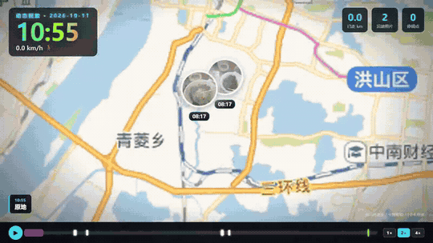
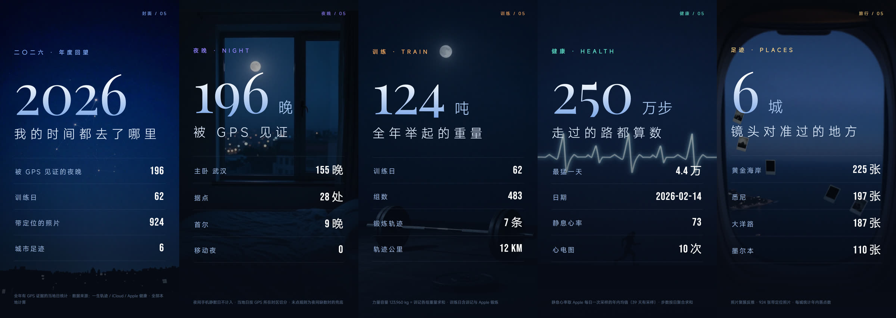
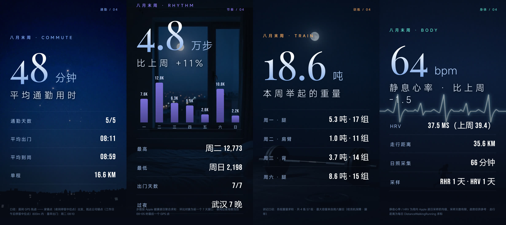

<div align="center">

# LifeDB · 大记理论

**你的人生，一个 SQLite 文件 —— 并且你的 AI agent 读得懂。**

> “一切你无法喂给AI的数据，都是白做的。” —— 孙哥

English · [中文](README.zh-CN.md) · [产品愿景](docs/PRODUCT.md)


*一条命令，从 295,135 个 GPS 点、1,668 张照片、125 次训练里生成的 32 秒人生电影。[看完整版 →](docs/assets/lifedb-movie.mp4)*

</div>

---

## 问题

你每天产生的个人数据比任何时代都多——位置、照片、训练、睡眠、心率、笔记。
但它们全部**散落着**：锁在互不相通的 App 里，躺在别人的服务器上，
够不着那个唯一能把它们变成意义的东西。

**你的 AI agent 一个都看不见。所以它们全是白做的。**

Google 刚刚对几十亿用户删掉了 Timeline 网页版。你的位置历史，
不该活在明天就能关掉的服务器上。

## 两个承诺

### 🤖 Bring Your Own Agent（自带 Agent）

LifeDB 不是一个 App。它是一个**本机 MCP 服务**——一个你的 AI agent 真正能用的数据库。

```json
{ "mcpServers": { "lifedb": { "command": "lifedb-mcp" } } }
```

接入就是这一行。Claude（或任何支持 MCP 的 agent）立刻获得七个读你人生的工具：
*那天发生了什么、那周我在哪、给我生成 2024 的地图、我通勤有多远。*
七个走索引的查询——不暴露任意 SQL，不做全表扫描。

下面的 demo 不是产品路线图，是**示例**——证明 agent 能在这个契约上盖出什么。
应用层是你的：接上 MCP，写你的应用，结束。

### 🔒 Bring Your Own Data（自带数据）

- **数据不出本机。** 无云端、无账号、无遥测、零上传。
  一个你完全拥有的 SQLite 文件——可备份、可删除、可带走。
- **导入 adapter 是插件**——一个 manifest + 一个脚本。内核只定义契约，
  连接器由社区共建。（想让你的数据源被支持？看下面的招募清单，欢迎 PR。）
- **开放格式。** 它就是 SQLite。今天用 `sqlite3` 查它，十年后还是。
  从设计上就没有锁定。

## 大家用它造什么

<table>
<tr>
<td width="50%">
<b>📍 单日回放</b><br>
一天实时回放：相机跟随 GPS 穿城移动，照片在拍摄地弹出。配套跨模态
<a href="docs/assets/day-card.jpg">英雄日卡 →</a>，照片按 EXIF 时刻钉回轨迹。
<br>
<a href="docs/assets/day-replay.mp4">看完整版 →</a>
</td>
<td width="50%">
<b>🧭 多日行程回放</b><br>
多天行程拼成一条连续旅程：传入第二个日期，轨迹自动拼接——跨城停留、
照片气泡、一条时间轴。
<br>
<a href="docs/assets/trip-replay.mp4">看完整版 →</a>
</td>
</tr>
<tr>
<td width="50%">
<b>📊 年度 Wrapped</b><br>
Spotify 年度总结式的分享卡，9:16 竖版，完全自托管。GPS 见证的夜晚、
举起的公斤、拍过的城市。

</td>
<td width="50%">
<b>🗓️ 本周回顾</b><br>
每周一早，一张卡落进你的聊天窗口：通勤用时、步数节奏、训练容量、
静息心率趋势。由 cron 定时任务生成，走的是外部 agent 一模一样的 MCP 工具。

</td>
</tr>
</table>

以上全部是 **demo**，不是围栏花园。所有数据都流经下面这七个 MCP 工具。

## 快速开始

```bash
pip install lifedb            # 或: pipx install lifedb
```

```bash
life-db init                            # 建库 timeline.db
life-db ingest events.jsonl             # 统一 JSONL 契约，幂等可重放
life-db query 2026-10                   # 某月全模态时间线
life-db around 2026-10-13T09:00 --window 2h   # 那一刻前后发生了什么
life-db stats                           # 覆盖度与计数
```

接入你的 agent（Claude Desktop / Claude Code / 任意 MCP 客户端）：

```json
{
  "mcpServers": {
    "lifedb": {
      "command": "lifedb-mcp",
      "env": { "LIFEDB_DB": "/path/to/timeline.db" }
    }
  }
}
```

### MCP 工具面（v0.1）

| 工具 | 给 agent 的能力 |
|---|---|
| `lifedb_stats` | schema 版本、各模态计数、时间覆盖 |
| `lifedb_query_month` | 整月时间线 |
| `lifedb_around` | 任意时刻前后的跨模态事件 |
| `lifedb_geo_track` | 任意时间窗的原始 GPS 轨迹（地图渲染用）|
| `lifedb_export_atlas` | 一站式打包：轨迹 + 事件 + 照片 |
| `lifedb_ingest_jsonl` | 唯一写入口——幂等，默认 dry-run |
| `lifedb_adapters` | 发现已安装的数据源插件 |

工具只增不改不删——这是契约。

## 数据源

adapter 是**插件**：一个 JSON manifest + 一个脚本，自动发现。现已支持：

| 数据源 | 数据 | 模式 |
|---|---|---|
| 手机 GPS 轨迹 | 11 年秒级定位点 | periodic |
| 训记 (xunji) | 力量训练：组数、容量、动作 | periodic |
| Apple 健康导出 | 睡眠、锻炼轨迹、心电、健康指标 | manual |
| Google Timeline | 停留段与位移段 | manual |
| 照片库 | EXIF GPS → 照片层 | manual |
| iCloud 同步 | 自动下载流水线 | periodic |

**招募中——欢迎 PR：** Hevy / Strong / Strava CSV · GPX / FIT ·
Google Takeout（新版 Records.json）· Obsidian 库 · Keep / 小米运动 /
华为运动健康 · Garmin 导出。接口契约见 [docs/PRODUCT.md](docs/PRODUCT.md) §3.3——
一个 manifest 和一个脚本就够了。

## 架构

```
你的 agent      Claude / Cursor / 任何说 MCP 的东西
    ⬇  stdio（仅本机）
MCP 服务        lifedb-mcp —— 契约层（7 个工具，无任意 SQL）
    ⬇
内核            SQLite timeline.db + 统一 JSONL 导入层 + CLI
    ⬇
你的数据        手机 GPS · 训练 · 健康 · 照片 · 时间线
```

## 文档

- [产品愿景与路线图](docs/PRODUCT.md) —— 架构、招募中的 adapter、阶段计划
- [内核设计](docs/DESIGN.md) · [导入手册](docs/INGESTION.md)
- [PRD（功能规格）](docs/PRD-lifedb-visual-app.md)

## 许可

MIT —— 见 [LICENSE](LICENSE)。
